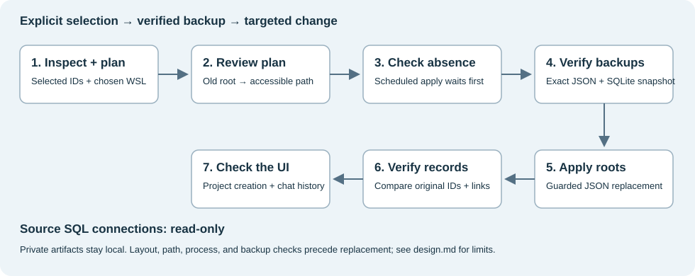

# Windows Codex project repair

[](https://github.com/BurnyCoder/codex-windows-project-repair/actions/workflows/windows.yml)

An unofficial utility for investigating legacy Linux project roots in **Windows Native** Codex Desktop profiles. It previews explicit selections, resolves folders through a chosen WSL distribution, and can apply reviewed root changes after process-absence checks and verified backups. Only selected `rootPaths` arrays are transformed; the tool sends no SQL updates to the source chat database. See the [implementation and its limits](docs/design.md).



In one private case, the user reported **“Works now!”** after the original helper ran. Startup logged migration of 31 projects and all checked original project/chat IDs remained present. Later `fs/watch` path errors still occurred. The [sanitized case study](docs/case-study.md) distinguishes these observations from automated UI verification and from tests of this generalized tool. This is one case with an unproven causal explanation, not universal compatibility.

## Install and diagnose

Run these commands in **native Windows PowerShell**, using your regular Windows account. Install [Git](https://git-scm.com/downloads/win) and [uv](https://docs.astral.sh/uv/getting-started/installation/) first. With default [uv settings](https://docs.astral.sh/uv/guides/projects/), `uv sync` downloads Python 3.14 if needed and creates a local `.venv`.

```powershell
git clone https://github.com/BurnyCoder/codex-windows-project-repair.git
cd codex-windows-project-repair
uv sync --frozen --python 3.14
Copy-Item .env.example .env
uv run --frozen --env-file .env codex-project-repair inspect
```

`inspect` reads the legacy project inventory and discovers the installed desktop package and registered WSL distributions. It reports IDs, names, roots, and candidate status without writing profile data or report files. `linux_root` means a supported *shape*, not proof that the entry caused your error. Other records remain visible as `not_a_supported_repair_target`.

The private case included this sanitized log error while project creation was failing:

```text
[host-app-server-projects] Local app-server assignment sync failed
Invalid request: AbsolutePathBuf deserialized without a base path
```

Check [Codex's Windows troubleshooting documentation](https://learn.chatgpt.com/docs/windows/windows-app) and the [related Windows Native report](https://github.com/openai/codex/issues/41290#issuecomment-6066451501). A generic “failed to create this project” message alone does not establish this cause. The original issue also describes a separate WSL-mode regression.

## Preview, apply, verify

Replace the example values below with an ID and the exact distribution name reported by `inspect`. Repeat `--project` for each project you intentionally select.

```powershell
uv run --frozen --env-file .env codex-project-repair plan --project "PROJECT-ID" --distro "YOUR-DISTRIBUTION"
Get-Content .local/plan.json
uv run --frozen --env-file .env codex-project-repair apply --plan .local/plan.json --check-only
```

Review each old root and proposed Windows path. An existing directory is translated by that distribution's `wslpath -w` and checked from Windows. The immediate parent must be a searchable directory; files, broken symlinks, unusable translations, and detected access/execution failures block a proposal. Missing-root evidence also requires explicit **`--detach-missing`**. Detachment sets that selected project's roots to `[]`; it deletes no folder or project record and retains other decoded state, including ordering and chat associations. An absent parent is treated as unverifiable. These are [metadata checks with limitations](docs/design.md#boundaries), not tests of every file's permissions.

Plans are never overwritten. Use `--save .local/another-plan.json` for a new preview. Regenerate a plan if folder availability changes. The scheduled worker checks its SHA-256 to reject edits made after scheduling.

To apply through Task Scheduler, run:

```powershell
powershell.exe -NoProfile -ExecutionPolicy Bypass -File scripts/schedule-repair.ps1 -Plan .local/plan.json
Get-Content .local/status.json
```

The launcher returns a task name and `launch_requested`. **Wait until the current worker's status says `waiting_for_codex_to_close`, then fully quit Codex.** Match the status timestamp to this launch; an old status file is not evidence that a new worker started. See `.local/launcher-*.log` if it never becomes ready. Keep this checkout and its `.venv` in place until the worker finishes.

The task runs as the current user without elevation or a saved password. Its Python worker waits up to 30 minutes for sustained process absence, rechecks the plan, verifies JSON/SQLite backups, and uses Windows `ReplaceFileW` for the JSON change. Process absence does not prove orderly shutdown; quit normally. After successful application it requests reopening. The wrapper attempts task removal in `finally`; hard termination or cleanup errors can leave a registration. `applied` means the JSON change was verified; `reopen_requested` does not prove the app opened. See [lifecycle limits](docs/design.md#boundaries) and [recovery](docs/recovery.md).

Alternatively, fully quit Codex and run this from a **separate PowerShell window**:

```powershell
uv run --frozen --env-file .env codex-project-repair apply --plan .local/plan.json --reopen
```

The initial detached-worker attempt did not complete in the observed case; its termination mechanism is unknown. A later scheduler run completed, as recorded in the [case study](docs/case-study.md#targeted-intervention).

After reopening, use the exact backup directory reported in `status.json`:

```powershell
uv run --frozen --env-file .env codex-project-repair verify --backup ".local/backups/BACKUP-TIMESTAMP"
```

`verify` checks backup hashes, original legacy project IDs and prior assignment entries, and missing IDs in the database's `threads` and `projects` tables. New records are allowed; equal counts cannot hide a missing old ID. A completed verification reports `needs_ui_verification`: try adding a Windows project, inspect startup logs, and check historical chat grouping yourself. Record presence is not full record-content or UI verification. See the [verification implementation](src/codex_windows_project_repair/workflow.py).

Exit codes from the [CLI](src/codex_windows_project_repair/cli.py) are `0` for command success, `1` for caught execution/validation failures, and `2` for preservation mismatches **or invalid command-line arguments**, following [argparse's usage-error behavior](https://docs.python.org/3.14/library/argparse.html#exiting-methods). Read the output to distinguish them. `inspect` can return diagnostic error fields with exit `0`; this is not application readiness.

## Configuration and recovery

The optional `.env` contains `CODEX_REPAIR_HOME` and `CODEX_REPAIR_OUTPUT`. Blank values use `CODEX_HOME` or the current user's `.codex` directory, and `.local` under the current working directory, respectively. Use absolute paths with forward slashes for overrides. The global `--home` and `--output` options, placed before a command, override these defaults. The scheduler loads the checkout's `.env` and pins its resolved profile/output paths during preflight.

Plans, backups, status, and logs contain private metadata. Keep them under the ignored `.local` directory outside the Codex profile. A SQLite snapshot is not a backup of every external conversation file or project working tree. The utility implements no LLM calls or telemetry. `plan` and `apply` emit timestamped logs and capture completed diagnostic subprocess output after it returns; early failures or timeouts can leave gaps. `inspect` and `verify` print results without report files. See [logging behavior](docs/design.md#logging-and-status).

See [recovery and scheduler troubleshooting](docs/recovery.md) before manually restoring anything. No automatic database restore is performed.

## Scope and implementation

| Area | Supported / tested scope |
| --- | --- |
| Desktop | Private case: Windows package `26.1016.8120.0`, Windows Native mode, user-reported recovery with the original helper. Other versions are unverified. |
| Installation | One discoverable `OpenAI.Codex` MSIX registration with a `ChatGPT.exe` or `Codex.exe` application. Package version and AppUserModelID are discovered. |
| State | `.codex-global-state.json` with dictionary-valued `local-projects` and `thread-project-assignments`; selected records have matching IDs and one normalized absolute Linux root. |
| History | `state_5.sqlite` with `threads.id` and `projects.id`; opened read-only by the tool. |
| Runtime | Native Windows, Python 3.14, uv, Windows PowerShell 5.1 for the launcher, Task Scheduler, and a usable selected WSL distribution providing `/usr/bin/test` and `wslpath`. Exact tested environments are in [validation](docs/validation.md). |
| Exclusions | Multi-root selections, unknown layouts, Linux-host execution, missing/ambiguous desktop installations, and inaccessible filesystem paths are refused. |

Features include explicit selection, strict JSON parsing, read-only diagnosis, SQLite snapshots, backup checksums, repeat-application checks, concurrent-edit checks, and worker exclusion within a Windows session. `ReplaceFileW` retains its documented metadata, not every file attribute, and can fail after partial changes. Python's standard library implements the repair; uv manages the environment/build and loads `.env`, and PowerShell handles scheduling. [Design and sources](docs/design.md) explain these boundaries.

`cli.py` is the command wrapper; `planning.py` validates and builds proposals, `windows.py` handles OS observations, `storage.py` transforms and backs up data, and `workflow.py` coordinates application and verification. The scheduler reuses the same `apply` command. See [design, limitations, and sources](docs/design.md).

## Validate a checkout

```powershell
uv run --frozen python -m unittest discover -s tests -v
uv run --frozen codex-project-repair --help
uv build
```

Optional scheduler integration checks create temporary tasks in an interactive Windows session. Run these only when that system activity is appropriate; they were **not rerun during the repository correction audit**:

```powershell
powershell.exe -NoProfile -ExecutionPolicy Bypass -File tests/scheduler-smoke.ps1
powershell.exe -NoProfile -ExecutionPolicy Bypass -File tests/scheduler-smoke.ps1 -SimulateFailure
```

The Python suite retains the original seven repair tests and adds planning, backup-failure, schema, path-translation, parent-type/access, timeout, record-identity, and mutex cases. [Windows CI](.github/workflows/windows.yml) runs that suite, CLI help, and packaging. The separate [scheduler smoke script](tests/scheduler-smoke.ps1) asserts launcher completion, duplicate registration refusal, cleanup, and sentinel preservation using disposable fixtures. It does not execute the repair pipeline. See the [validation record](docs/validation.md) for what was actually run and its limitations.

[MIT licensed](LICENSE). This community utility is not an OpenAI product or a supported desktop migration API.
